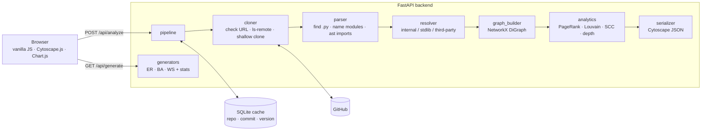

# RepoAtlas

[](https://github.com/Vivansh-07/RepoAtlas/actions/workflows/tests.yml)


**Paste a public GitHub repository and get an interactive map of how its Python modules depend on each other:** what's central, what clusters together, and where imports go round in circles.


[](https://render.com/deploy?repo=https://github.com/Vivansh-07/RepoAtlas)

---

## Why

Large codebases are hard to understand because their structure is invisible. A folder tree shows where files live, not which files rely on which, where the core of the system is, or where circular dependencies make every change risky. RepoAtlas reads a repository's imports and turns that hidden structure into a map in a few seconds.

It's for developers joining an unfamiliar codebase, tech leads planning a refactor, reviewers checking whether a change touches a heavily used module, and students who want to learn from open source but don't know where to start reading.

## Features


### Repo Explorer
- **One URL in, a dependency graph out.** Accepts `https://github.com/owner/repo` or just `owner/repo`.
- **Visual analytics on top of the graph**
  - size = importance (PageRank)
  - colour = cluster (Louvain communities)
  - red halo = circular dependency (strongly connected components)
  - dashed arrow = type-only import (`if TYPE_CHECKING:`)
- **Four layouts**, each answering a question:
  - **Force:** what belongs together?
  - **Hierarchy:** what builds on what? (a layered layout written for this project)
  - **Rings:** where is the core?
  - **Circle:** how big is each cluster?
- **Explore:**
  - hover for focus + context
  - click for a details card (path, lines, rank, community, clickable *imports* and *imported by*)
  - search with suggestions
  - zoom, with labels appearing as nodes grow on screen
- **Show options:** external libraries, type-only imports, only circular dependencies. These are instant, because filtering happens in the browser.
- **Summary panel:** modules, imports, communities, cycle groups, dependency depth, modularity, and the 10 most important modules.
- **Shareable links** (`/?repo=pallets/flask&layout=hierarchy&cycles=1`) and **PNG export** of the current view.

### Graph Lab
- Generate **Erdős–Rényi**, **Barabási–Albert** and **Watts–Strogatz** random graphs with sliders and a seed, so any graph can be reproduced.
- **Statistics** chosen to show each model's signature: degree distribution and max degree (scale-free hubs), clustering and average path length (small world), components and giant-component size (the ER phase transition).
- **Degree-distribution chart** with a **log–log** mode, where a power law becomes a straight line.
- Watts–Strogatz **shortcuts drawn in violet** on the ring.

| | |
|---|---|
|  |  |
| **Click a module:** details, imports and imported-by, with its neighbourhood in focus. | **Hierarchy:** tests on top, foundations at the bottom, each cycle group on one red row (pallets/click). |
|  |  |
| **Only circular dependencies:** Flask's 11-module core loop and an example app's 2-module loop. | **Graph Lab:** a Watts–Strogatz small world, a ring plus a few random shortcuts. |

## Reading the map

| You see | It means |
|---|---|
| A circle | One Python module (one `.py` file; a package's `__init__.py` is the package) |
| An arrow A → B | A imports B: A depends on B |
| Bigger circle | Higher PageRank: important modules depend on it |
| Same colour | Same Louvain community: these modules import each other a lot |
| Red ring and halo, red arrows | Part of a circular dependency |
| Grey | No imports to or from the rest of the repo |
| Dashed arrow | Type-only import: it never runs, so it can't cause a circular-import error |
| Dashed grey circle | External library (shown on request) |

## What it finds in real code

| Repository (commit) | Modules | Imports | Communities (modularity) | Cycle groups | Depth | Most important |
|---|---|---|---|---|---|---|
| pallets/flask (`d73fa1c`) | 82 | 162 (+24 type-only) | 8 (0.37) | 11, 2 | 9 | `flask`, `flask.globals` |
| psf/requests (`611c616`) | 35 | 94 (+12) | 6 (0.21) | none | 10 | `requests.compat` |
| pallets/click (`2247b35`) | 90 | 163 (+5) | 4 (0.30) | 7, 2, 2 | 6 | `click._compat` |
| encode/httpx (`b5addb6`) | 60 | 116 (+6) | 4 (0.37) | 2 | 11 | `httpx`, `httpx._types` |

A few things these maps reveal:
- **Flask's core is one 11-module loop.** `app`, `blueprints`, `cli`, `templating`, `wrappers` and the package itself all reach each other. It still works at runtime because Flask defers some imports into functions.
- **The biggest file isn't the most important.** `flask.app` has 1,238 lines but ranks #27: five of its six importers use it only for type hints.
- **A legacy shim became load-bearing.** requests' #1 module is `requests.compat`, a Python 2/3 compatibility layer still imported by 14 modules.
- **Some cycles only exist on one platform.** click's `_compat ↔ _winconsole` loop only runs on Windows (`if sys.platform.startswith("win")`).

## How it works



1. **Validate** the URL strictly, then ask GitHub for the latest commit with `git ls-remote`, without downloading anything.
2. **Cache check** on (repo, commit, analysis version). A repeat request skips everything below: about 1 s instead of about 5 s.
3. **Shallow clone** into a temporary folder, deleted afterwards whatever happens.
4. **Parse** every `.py` file with Python's `ast`. The code is read as data and never run.
5. **Resolve** each import: longest matching module, relative imports, the script-folder rule, stdlib versus third-party.
6. **Build** a directed graph (A → B means "A imports B") and run the **analytics** on the repo's own runtime imports.
7. **Serialize** to Cytoscape's `{"data": {...}}` format, so the browser draws it as-is.

## Design decisions

| Decision | Why | Rejected alternative |
|---|---|---|
| Parse with `ast` | Safe: a malicious repo can't run code on the server; handles all syntax | Regex (breaks on strings and multi-line imports); importing the code (unsafe) |
| Cycles as strongly connected components | Linear time, and answers "which modules are tangled together?" | Listing every simple cycle (can take exponential time) |
| Type-only imports as dashed edges, excluded from analytics | They never run. Counting them turned Flask's core into a fake 20-module cycle and gave requests an 8-module one that doesn't exist. | Dropping them (loses information) or counting them (fake cycles) |
| Analytics on the repo's own modules only | `typing` would top every ranking, and toggling libraries must not change sizes or colours | Analysing whatever is visible |
| Our own layered layout (simplified Sugiyama) | Cytoscape's breadth-first layout put 60 test modules on one row. Ours collapses cycle groups (condensation), assigns layers by longest path, orders by community and wraps rows. | `breadthfirst`; adding a dagre dependency |
| Circle area ∝ importance (square-root sizing) | Viewers judge circles by area | Linear diameter (exaggerates the top module) |
| Cache key = repo + commit + analysis version | A commit is an exact snapshot, so its analysis never changes; the version invalidates old results when the analysis logic changes | Time-based expiry (stale or wasteful) |
| Git with credential helpers disabled | Private repos fail fast as 404 instead of hanging on a login prompt, and the server never uses saved credentials | Relying on the timeout |
| At most 2 analyses at once, then 503 | A free instance has about 512 MB of RAM; cache hits bypass the limit | Unlimited (crashes under a burst) |
| Vanilla JS as ES modules, CDN libraries pinned with integrity hashes | No build step; tampered CDN files are refused by the browser | React plus a bundler |

## API

| Endpoint | Purpose |
|---|---|
| `GET /api/health` | `{"status": "ok"}` |
| `POST /api/analyze` | Body `{"repo_url": "https://github.com/pallets/flask", "include_external": false}`. Returns the commit, a `cached` flag, the summary, and the nodes and edges in Cytoscape's format |
| `GET /api/generate?model=ba&n=200&m=2&seed=1` | Random graph (`er`: n, p · `ba`: n, m · `ws`: n, k, p). Returns the stats, the degree distribution, and the nodes and edges |

Errors always look like `{"detail": "..."}`: 400 bad URL or parameters · 404 not found or private · 413 too many files · 422 no Python files · 502 git failed · 503 busy · 504 timed out. Interactive docs are at `/docs`.

## Running it

```bash
python -m venv .venv
.venv\Scripts\activate           # macOS/Linux: source .venv/bin/activate
pip install -r requirements-dev.txt
uvicorn app.main:app --reload    # http://127.0.0.1:8000
pytest -q                        # run the tests
```

Requires Python 3.11+ and `git` on your PATH. `requirements.txt` is the runtime set; `requirements-dev.txt` adds the test tools.

**Docker:** `docker build -t repoatlas . && docker run -p 8000:8000 repoatlas`. The image is `python:3.13-slim` plus `git`, running as a non-root user.

**Deploy:** `render.yaml` is a Render Blueprint (a free Docker web service with a health check and auto-deploy on push). Use the button above, or Render → New → Blueprint.

## Testing and CI

**135 tests** (pytest). They cover:
- URL validation, including injection attempts
- path → module naming on real layouts (src/, nested projects, name clashes)
- every import-resolution rule, plus a fake repository with a known graph and one cycle
- analytics, the cache and the API (offline, with GitHub faked)

Several Graph Lab tests check **graph theory** rather than shape: ring-lattice clustering = 3(k−2)/(4(k−1)), the small-world drop in path length, Barabási–Albert hubs versus Erdős–Rényi, and exact edge counts.

GitHub Actions runs two jobs on every push and pull request:
- **pytest**
- **docker:** builds the production image, starts it, and analyses a real repository *inside the container*

## Limitations

- Python only; public GitHub repositories only; at most 2,000 Python files (files over 1 MB are kept as nodes but not parsed).
- Static analysis: `importlib.import_module("…")` and other dynamic imports aren't seen; conditions aren't evaluated (an import inside `if sys.platform == "win32"` counts everywhere). `if TYPE_CHECKING:` imports are recognised.
- Tests are included, so the modules tests import most (often the package `__init__`) rank high.
- Imports that only work because code edits `sys.path` at runtime appear as external libraries.

## Future work

- Collapse packages into compound nodes for very large repositories
- Compare two repositories, or two commits of one, side by side
- Function-level call graphs
- Stream real progress (Server-Sent Events) instead of estimated loading steps

## License

[MIT](LICENSE) © 2026 Vivansh Garg
